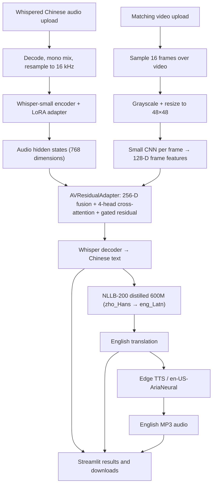

# Project Architecture

## 1. Purpose and scope

The active application in `app.py` is an **audio-visual Chinese transcription and English dubbing demo**. It takes whispered Chinese audio and its matching video, predicts a Chinese transcript, translates the transcript into English, and synthesizes English speech.

The output is English speech generated from text. This project does not restore normal-sounding Chinese from whispers and does not clone/preserve the original speaker's voice.

## 2. Active data flow



The diagram describes the intended code path in `app.py`. The app preprocesses audio as mono and 16 kHz, rejects audio longer than 120 seconds, samples up to 16 video frames across the clip, converts them to grayscale, resizes frames to 48 × 48, and pads by repeating the last frame if fewer than 16 frames are read.

## 3. Models and components

| Component | Model/configuration | Role |
|---|---|---|
| Base ASR | `openai/whisper-small` | Audio encoder and text decoder, hidden dimension 768 |
| ASR adaptation | PEFT LoRA, adapter at `outputs/whisper_lora_small/` | Low-rank adaptation; training script targets `q_proj` and `v_proj`, rank 8, alpha 16, dropout 0.05 |
| Visual fusion | `AVResidualAdapter` in `app.py`, checkpoint `outputs/av_transcription_full.pt` | CNN frame encoder, 128-D visual features, 256-D fusion features, 4-head multi-head attention and gated residual correction |
| Translation | `facebook/nllb-200-distilled-600M` | NLLB-200 English translation using Chinese source code `zho_Hans` and English target code `eng_Latn` |
| Speech generation | Edge TTS voice `en-US-AriaNeural` | Converts translated English text to synthesized English speech |
| UI | Streamlit | Accepts uploads and displays text and audio player/download |

### Offline benchmark models

- `openai/whisper-large-v3` is used by separate evaluation scripts as a stronger ASR comparison model. It is not loaded by `app.py`.
- Base `openai/whisper-small` predictions are compared with the same model plus the project LoRA adapter.
- AV pilot and expanded-training experiments use frozen Whisper-small + LoRA and train an AV residual adapter with a transcript cross-entropy objective.

### Inactive models and paths

The older acoustic conversion experiments (audio/video-to-mel, mel reconstruction, and HiFi-GAN/vocoder experiments) are retained under `archive/conversion_experiments/`. They are not part of the active app, which generates English audio using Edge TTS after translation.

## 4. Checkpoints and runtime loading

- `outputs/whisper_lora_small/` must contain the PEFT adapter and tokenizer files.
- `outputs/av_transcription_full.pt` must contain the `av_adapter` state dict expected by `app.py`.
- The base Whisper and NLLB models are downloaded by Transformers on first use and cached locally.
- The app uses the GPU when `torch.cuda.is_available()` and otherwise falls back to CPU. CPU inference will be slower.
- Models are cached across Streamlit reruns using `st.cache_resource`.

**Checkpoint/result caveat:** `FINAL_RESULTS.txt` records historical results for `outputs/av_transcription_pilot.pt`. That pilot checkpoint is not the checkpoint loaded by the current `app.py`; its results must not be presented as measurements of `outputs/av_transcription_full.pt`.

## 5. How to run

Install dependencies and launch from the repository root:

```bash
python -m pip install -r requirements.txt
python -m streamlit run app.py
```

Local browser URL is typically `http://localhost:8501`. For remote servers, open the forwarded port URL provided by the host.

## 6. Dataset and training dependencies

The interactive demo requires its checkpoint files and model downloads, plus matching user-uploaded audio and video. It does not require the full training dataset to be present.

Training and offline evaluation scripts are separate workflows and usually require local datasets and prepared files under `outputs/`, including manifests and video-feature arrays. Raw dataset and cache folders are git-ignored. They need to be obtained separately, subject to the dataset license; a Hugging Face token is not automatically used by `app.py`.

## 7. Evaluation and validation status

The evaluation scripts cover character error rate (CER), some word error rate (WER) comparisons, per-utterance results, per-speaker CER, and exact/empty output checks. See [docs/EVALUATION_RESULTS.md](docs/EVALUATION_RESULTS.md) for recorded and recomputed numbers, metric definitions, dataset coverage, and limitations.

The three saved official-test ASR prediction CSVs have been scored on the same 3,289 clips in the report's NFKC/lowercase/alphanumeric normalization. Their results compare ASR models, but do not validate the translation or speech generation stages. The complete upload-to-English-audio path still requires an end-to-end test with a real matching audio/video pair.
