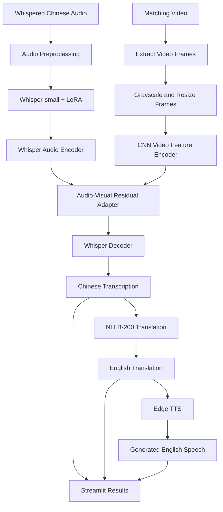

# Audio-Visual Chinese Whisper Transcription → English Speech

An audio-visual speech understanding application that accepts whispered Chinese audio and a matching video, predicts Chinese text, translates the transcript into English, and generates spoken English using text-to-speech.

The application is built using Whisper, a trained LoRA adapter, an audio-visual residual adapter, NLLB-200 translation, Edge TTS, and Streamlit.

> **Complete pipeline:** Chinese Audio + Matching Video → Audio-Visual Transcription → Chinese Text → English Translation → English Speech

---

## 1. Project Overview

Whispered speech can be difficult to recognize because it has different acoustic characteristics from normal speech. This project investigates how audio information and visual information can be combined to improve Chinese transcription, followed by English translation and speech generation.

### Main Features

- Upload whispered Chinese audio and its matching video.
- Convert audio to mono and resample to 16 kHz.
- Extract and preprocess video frames.
- Recognize Chinese text using Whisper-small and a trained LoRA adapter.
- Incorporate visual features through an audio-visual residual adapter.
- Translate recognized Chinese text into English using NLLB-200.
- Generate spoken English using Edge TTS.
- Display the predicted Chinese transcription, English translation, and generated speech in a Streamlit interface.
- Play the generated English speech directly in the browser.
- Download the generated English speech as an MP3 file.
- Preserve the current pipeline output when Streamlit reruns after downloading the audio.
- Clear the currently displayed pipeline output using the **Clear Output** button.
- Maintain a session-only output history containing previous pipeline runs, their transcriptions, translations, audio players, and download buttons.
- Clear the complete session output history using the **Clear Log History** button.

### Project Objectives

1. Develop a Chinese transcription pipeline for whispered audio.
2. Explore audio-visual feature fusion for speech recognition.
3. Adapt a pretrained Whisper model to the project's transcription task.
4. Translate recognized Chinese text into English.
5. Generate English speech from the translated text.
6. Evaluate transcription performance using character error rate and other applicable metrics.

### Important Scope

The current application generates **English speech from translated text**. It does not reconstruct normal-sounding Chinese speech from whispered input, and it does not preserve or clone the original speaker's voice.

---

## 2. System Architecture

The application contains three primary processing stages:

1. Audio-visual Chinese transcription.
2. Chinese-to-English translation.
3. English speech synthesis.

### Architecture Diagram



### Stage 1: Audio Preprocessing

The application accepts an audio file and reads its samples. If the input contains multiple channels, the channels are mixed into mono. Audio is resampled to 16 kHz when necessary.

The application rejects uploaded audio longer than 120 seconds.

### Stage 2: Video Preprocessing

The application extracts up to 16 frames distributed across the supplied video.

Each frame is:

- Converted to grayscale.
- Resized to 48 × 48 pixels.
- Scaled to floating-point values between 0 and 1.

When fewer than 16 frames can be extracted, the application repeats the last available frame to complete the expected sequence.

The current implementation uses whole grayscale frames rather than a dedicated mouth-region crop.

### Stage 3: Audio Feature Extraction

Whisper-small encodes the input audio into hidden representations. The trained LoRA adapter modifies the pretrained Whisper model for the project's transcription task.

The audio encoder representation has a hidden dimension of 768.

### Stage 4: Audio-Visual Feature Fusion

The `AVResidualAdapter` processes the visual frames using a small convolutional neural network.

Its main components are:

- CNN-based visual feature extraction.
- 128-dimensional visual features.
- A 256-dimensional fusion representation.
- Four-head multi-head cross-attention.
- A gated residual connection to Whisper encoder representations.

The adapter combines audio representations with information extracted from the video. The Whisper decoder then generates the Chinese transcript.

Visual information may help in some examples, but audio-visual fusion is not guaranteed to improve every transcription.

### Stage 5: Chinese-to-English Translation

The predicted Chinese transcript is passed to NLLB-200 distilled 600M.

The configured language codes are:

- Source: `zho_Hans`
- Target: `eng_Latn`

The model generates the corresponding English translation.

### Stage 6: English Speech Generation

The translated English text is passed to Edge TTS using the voice `en-US-AriaNeural`.

The synthesized result is returned as English audio and presented in the Streamlit interface, where users can play and download the result.

---

## 3. Models and Technologies Used

| Component | Model or Technology | Purpose |
|---|---|---|
| Base speech recognition | `openai/whisper-small` | Encodes audio and generates Chinese transcription |
| Speech model adaptation | PEFT LoRA | Adapts Whisper-small for the project's transcription task |
| Audio-visual fusion | `AVResidualAdapter` | Integrates video features with Whisper encoder representations |
| Translation | `facebook/nllb-200-distilled-600M` | Translates Chinese text into English |
| Speech generation | Edge TTS | Generates spoken English from translated text |
| Deep learning framework | PyTorch | Model training and inference |
| Model library | Hugging Face Transformers | Loads Whisper and NLLB models |
| Adapter library | PEFT | Loads and manages the LoRA adapter |
| Computer vision | OpenCV | Extracts and processes video frames |
| Audio processing | Librosa and SoundFile | Loads, converts, and resamples audio |
| User interface | Streamlit | Provides uploads, results, audio playback, and downloads |

### 3.1 Whisper-small

**Model identifier:** `openai/whisper-small`

Whisper-small is the pretrained automatic speech recognition model used by the active application.

It processes audio and generates Chinese text. The model is used together with the project's trained LoRA adapter and AV residual adapter.

The base model may need to be downloaded from Hugging Face on the first run.

### 3.2 Whisper LoRA Adapter

**Directory:** `outputs/whisper_lora_small/`

The PEFT LoRA adapter adapts Whisper-small to the project's transcription task without requiring every parameter of the base model to be trained.

The training script configures:

| Parameter | Value |
|---|---|
| Base model | Whisper-small |
| LoRA rank | 8 |
| LoRA alpha | 16 |
| LoRA dropout | 0.05 |
| Target attention modules | `q_proj`, `v_proj` |

The existing training script uses a small pilot sample by default. These parameters describe the script configuration and do not, by themselves, prove the exact provenance of the saved adapter.

The adapter is not a standalone Whisper model; the corresponding base model is also required.

### 3.3 AVResidualAdapter

**Checkpoint:** `outputs/av_transcription_full.pt`

The AV residual adapter adds visual information to Whisper's audio encoder representations.

It uses a CNN for frame encoding and cross-attention to incorporate video features. A gated residual connection produces a corrected representation for the Whisper decoder.

The current application expects the checkpoint to contain an `av_adapter` state dictionary.

### 3.4 NLLB-200

**Model identifier:** `facebook/nllb-200-distilled-600M`

NLLB-200 performs Chinese-to-English translation. It is separate from the Whisper transcription model and operates on the recognized text rather than directly on audio.

### 3.5 Edge TTS

**Configured voice:** `en-US-AriaNeural`

Edge TTS converts the English translation into synthesized spoken English. It requires network access to the speech synthesis service.

### 3.6 Offline Comparison Model

**Model identifier:** `openai/whisper-large-v3`

Whisper-large-v3 is used in separate offline transcription evaluation scripts. It provides a reference comparison for the Whisper-small experiments but is **not** the ASR model loaded by the active Streamlit application.

### 3.7 Archived Conversion Experiments

Earlier experiments investigated acoustic conversion, audio-to-mel prediction, mel reconstruction, and HiFi-GAN vocoding. Those experiments produced noisy reconstructed audio and are not part of the active application.

The current pipeline generates English speech from translated text instead of reconstructing normal-sounding Chinese.

---

## 4. Installation and Setup

### Step 1: Clone the Repository

```bash
git clone https://github.com/pradeep14012004/whisper-speech-conversion.git
cd whisper-speech-conversion
```

The repository may be private, so GitHub authentication and repository access may be required.

### Step 2: Create a Python Environment

```bash
python -m venv .venv
```

On Linux:

```bash
source .venv/bin/activate
```

On Windows PowerShell:

```powershell
.venv\Scripts\Activate.ps1
```

### Step 3: Install Dependencies

Install a PyTorch build compatible with the machine's CPU or CUDA environment. Then install the project dependencies:

```bash
python -m pip install --upgrade pip
python -m pip install -r requirements.txt
```

For reproducible training, use a tested environment that matches the project's Python, PyTorch, CUDA, and Transformers versions.

### Step 4: Verify the Required Model Files

The application expects the following model artifacts:

```text
outputs/
├── whisper_lora_small/
│   ├── adapter_config.json
│   ├── adapter_model.safetensors
│   └── tokenizer and processor files
└── av_transcription_full.pt
```

The base Whisper and NLLB models are loaded from Hugging Face as needed.

### Step 5: Run the Application

From the repository root:

```bash
python -m streamlit run app.py
```

Open the local URL shown in the terminal, typically:

```text
http://localhost:8501
```

For a remote server, use the public or forwarded port URL provided by the hosting service.

---

## 5. How to Use the Application

1. Start the Streamlit application.
2. Upload whispered Chinese audio.
3. Upload the matching video.
4. Click **Run complete pipeline**.
5. Review the predicted Chinese text.
6. Review the English translation.
7. Listen to the generated English speech.
8. Download the resulting MP3 file if required.
9. Use **Clear Output** to remove the currently displayed result.
10. Expand **Session Output Log** to review previous pipeline runs from the current Streamlit session.
11. Use the individual download buttons in the session log to download audio from previous runs.
12. Use **Clear Log History** to remove all stored results from the current session.

The current output and session history are stored in Streamlit session state. They remain available when the page reruns, including after clicking a download button, but they are cleared when the Streamlit server session ends or the history is manually cleared.


### Supported Input Formats

| Input | Supported formats |
|---|---|
| Audio | WAV, MP3, FLAC, OGG, M4A |
| Video | AVI, MP4, MOV, MKV, WEBM |

**Audio duration limit:** 120 seconds in the current application.

The supplied video should correspond to the uploaded audio. Unrelated video may provide misleading visual information.

---

## 6. Evaluation Results

This section separates the saved official-test ASR comparison from the historical AV pilot experiments.

The reported figures evaluate **Chinese transcription**, not the quality of the English translation or generated speech.

### 6.1 Official-Test ASR Comparison

The repository contains saved prediction CSVs for 3,289 official-test clips for each of the following models:

- Whisper-small base.
- Whisper-small with the project LoRA adapter.
- Whisper-large-v3.

The scores below were recomputed from these saved CSVs using one consistent normalization procedure:

1. Apply Unicode NFKC normalization.
2. Convert text to lowercase.
3. Retain Unicode letters and numbers while removing punctuation, whitespace, and symbols.
4. Calculate corpus Character Error Rate using total character edit distance divided by total normalized reference characters.

All three results use the same 3,289 clips and 65,134 normalized reference characters.

| Model | Test Clips | Corpus CER ↓ | Exact Matches |
|---|---:|---:|---:|
| Whisper-small base | 3,289 | 42.27% | 81 (2.46%) |
| Whisper-small + LoRA | 3,289 | 40.45% | 92 (2.80%) |
| Whisper-large-v3 | 3,289 | 18.81% | 798 (24.26%) |

**Interpretation:**

- Lower CER means fewer character-level transcription errors.
- On the saved predictions, Whisper-small + LoRA improves corpus CER by approximately 1.82 percentage points compared with the unadapted Whisper-small base.
- Whisper-large-v3 has the lowest CER in this comparison.
- Whisper-large-v3 is an offline comparison model, not the model used by the active Streamlit app.

These results are specific to the saved prediction files and the normalization method described above.

### 6.2 Per-Speaker CER Comparison

The saved official-test files contain 28 speaker groups, identified from the speaker directory in the audio paths.

| Model | Minimum Speaker CER | Median Speaker CER | Maximum Speaker CER |
|---|---:|---:|---:|
| Whisper-small base | 28.80% | 39.24% | 80.34% |
| Whisper-small + LoRA | 27.57% | 38.93% | 70.07% |
| Whisper-large-v3 | 5.60% | 17.02% | 46.64% |

These results show variation in transcription performance across speakers. They do not, by themselves, establish generalization to unseen speakers.

### 6.3 Historical Audio-Only versus Audio-Visual Pilot Results

The historical project results report contains additional measurements for the pilot checkpoint `outputs/av_transcription_pilot.pt`.

| Evaluation Split | Audio-Only CER | AV CER | Evaluation Coverage |
|---|---:|---:|---|
| Validation | 34.3943% | 28.1161% | 2,239 clips |
| Official-test matched subset | 40.6707% | 35.5825% | 2,274 of 3,289 clips |

The historical report records the following pilot results:

| Measurement | Reported Result |
|---|---:|
| Validation absolute CER reduction | 6.2782 percentage points |
| Validation relative CER reduction | 18.25% |
| Official-test absolute CER reduction | Approximately 5.0882 percentage points |
| Official-test relative CER reduction | Approximately 12.51% |
| Validation utterances improved by AV | 1,147 (51.2%) |
| Validation utterances worsened by AV | 556 (24.8%) |
| Validation utterances unchanged | 536 (23.9%) |
| Official-test visual-feature coverage | 2,274 / 3,289 (69.14%) |

The pilot experiments also reported:

- Low-learning-rate AV validation CER: **33.2322%**.
- Expanded-training AV validation CER: **37.9886%**.
- Selected historical pilot: the original AV pilot checkpoint.

### Important Checkpoint Distinction

The active application loads:

```text
outputs/whisper_lora_small/
outputs/av_transcription_full.pt
```

The historical AV pilot metrics use:

```text
outputs/av_transcription_pilot.pt
```

These are different checkpoints. **The historical pilot results must not be presented as measurements of the active full AV checkpoint.**

The official-test AV results cover only clips with available visual features. The unmatched examples are excluded from those AV metrics, and the incomplete visual-feature coverage may introduce selection bias.

A dedicated evaluation of `outputs/av_transcription_full.pt` remains necessary.

### 6.4 Evaluation Metrics Used

The project evaluation scripts implement or investigate the following metrics and comparisons:

| Metric or Check | Purpose |
|---|---|
| Character Error Rate (CER) | Measures character-level transcription errors |
| Word Error Rate (WER) | Measures word-level errors in comparison experiments |
| Per-utterance CER | Examines performance on individual clips |
| Per-speaker CER | Measures variation across speaker groups |
| Exact-match rate | Measures predictions identical to the normalized reference |
| Empty-prediction count | Detects outputs that contain no recognized text |
| AV versus audio-only comparison | Determines whether AV predictions improve, worsen, or match the baseline |
| Greedy versus beam-search comparison | Investigates decoding strategy effects |

A numeric WER summary and a committed beam-search result summary are not available in the currently documented artifacts.

### 6.5 Translation and Speech Quality Evaluation

The active application uses NLLB-200 for translation and Edge TTS for English speech synthesis.

The currently documented artifacts do not provide validated numeric results for:

- BLEU, chrF, or COMET translation metrics.
- Human translation-quality evaluation.
- Mean Opinion Score (MOS) or listener-based speech-quality evaluation.
- Objective generated-speech quality.
- Completed end-to-end performance across transcription, translation, and speech generation.

The ASR CER results should not be interpreted as measures of translation accuracy or speech quality.

---

## 7. Data and Reproducibility

The full training datasets and caches are not bundled in the GitHub repository.

The development server previously reported the following approximate folder sizes:

| Folder | Approximate Size |
|---|---:|
| `data/` | 3.8 GB |
| `train/` | 15 GB |
| `test/` | 3.5 GB |
| `cache16k/` | 6.5 GB |
| **Total** | **28.8 GB** |

These folders are excluded from normal Git tracking because of their size.

### Dataset Storage

For reproducibility:

- Document the official dataset source and license.
- Keep the raw data in local or external storage.
- Consider a private Hugging Face Dataset repository if the dataset license permits redistribution.
- Store instructions for downloading and preparing the data in the project.
- Do not commit access tokens, passwords, or other secrets.

The current application does not automatically download the dataset using a Hugging Face token.

The interactive demo does not require the complete training dataset. It needs the expected model checkpoints and user-uploaded audio/video files. Training and offline evaluation require the corresponding datasets, manifests, and video features.

---

## 8. Training and Evaluation Commands

Execute these commands from the repository root. Confirm that the required manifests, datasets, feature arrays, and checkpoints exist before running each script.

### Train the Whisper LoRA Adapter

```bash
python train_whisper_lora.py
```

The current script is configured as a small pilot run by default. It writes the adapter under `outputs/whisper_lora_small/`.

### Train the Full AV Transcription Adapter

```bash
python train_av_transcription_full.py
```

This training script requires CUDA and prepared AV training data. It expects the relevant training manifest and video features, including:

```text
outputs/train_av_manifest.csv
outputs/train_video_features/
```

### Recompute Official-Test ASR Metrics

```bash
python scripts/evaluation/score_official_predictions.py
```

The scoring script evaluates the saved prediction CSVs using the normalization described in the evaluation section. It reports CER, exact matches, empty outputs, and per-speaker CER.

### Legacy Scoring Script

```bash
python score_test.py
```

The legacy scorer optionally uses OpenCC to convert Traditional Chinese to Simplified Chinese. Because this differs from the normalization used for the scores above, its metrics may not match the documented comparison table.

**Warning:** Training commands may overwrite or create files under `outputs/`. Back up important checkpoints before retraining.

---

## 9. Project Structure

```text
whisper-speech-conversion/
│
├── app.py
├── av_fusion.py
├── project_paths.py
├── requirements.txt
├── README.md
├── ARCHITECTURE.md
├── FINAL_RESULTS.txt
│
├── outputs/
│   ├── whisper_lora_small/
│   ├── av_transcription_full.pt
│   └── evaluation/
│       ├── official_test_small_predictions.csv
│       ├── official_test_lora_predictions.csv
│       └── official_test_large_v3_predictions.csv
│
├── scripts/
│   ├── data_preparation/
│   ├── training/
│   ├── evaluation/
│   ├── translation/
│   └── tts/
│
├── archive/
│   └── conversion_experiments/
│
├── docs/
│   ├── PROJECT_STRUCTURE.md
│   ├── EVALUATION_RESULTS.md
│   └── architecture.mmd
│
└── examples/
```

### Key Directories

- `scripts/data_preparation/`: Manifest generation, training-data preparation, audio caches, and video features.
- `scripts/training/`: Whisper LoRA and AV adapter training implementations.
- `scripts/evaluation/`: Evaluation, scoring, model comparisons, and diagnostics.
- `scripts/translation/`: Chinese-to-English translation utilities.
- `scripts/tts/`: Standalone text-to-speech utilities.
- `outputs/`: Trained model artifacts and saved evaluation results.
- `archive/conversion_experiments/`: Inactive acoustic-conversion and HiFi-GAN experiments.

Root-level compatibility launchers remain available for many earlier commands.

---

## 10. Limitations and Future Work

### Current Limitations

- The active full AV adapter checkpoint has not yet been benchmarked in a committed end-to-end evaluation.
- Historical AV pilot metrics were produced with a different checkpoint.
- Official-test AV metrics use only a matched subset of the available examples.
- Whole-frame grayscale video features may contain limited lip-motion information.
- Audio-visual fusion is not guaranteed to improve every transcript.
- CER scores depend on the text normalization and dataset coverage used for scoring.
- Translation and generated-speech quality have not been quantitatively validated in the committed results.
- Edge TTS requires network access.
- The pretrained Whisper and NLLB models may need to be downloaded on first use.
- The pipeline generates English speech from text and does not preserve the original speaker's voice.

### Future Improvements

- Evaluate the active full AV checkpoint on a clearly defined validation and test set.
- Increase and verify video-feature coverage.
- Investigate mouth-region cropping and more informative visual features.
- Run speaker-independent evaluation.
- Add a repeatable end-to-end test for transcription, translation, and speech synthesis.
- Evaluate translation with appropriate automatic and human metrics.
- Evaluate synthesized English speech with listener studies or suitable speech-quality measurements.
- Document dataset provenance, licenses, and exact training environment versions.
- Provide reproducible experiment configurations and logs.

---

## 11. Conclusion

This project combines speech recognition, audio-visual feature fusion, neural machine translation, and text-to-speech synthesis in a single application.

The current system uses Whisper-small with a trained LoRA adapter and an AV residual adapter to predict Chinese text, NLLB-200 to translate the recognized text into English, and Edge TTS to synthesize English audio.

Saved official-test predictions show that Whisper-small plus LoRA improves CER over the unadapted Whisper-small base in the documented comparison. A separate historical pilot report shows improvements from AV fusion, but those measurements belong to a different checkpoint and should not be attributed to the active full adapter without further evaluation.

The project provides an interactive demonstration of an audio-visual speech understanding and translation pipeline, while further testing is needed to establish the performance of the complete active system.

---

## Technologies Acknowledged

OpenAI Whisper · Hugging Face Transformers · PEFT · NLLB-200 · PyTorch · Streamlit · OpenCV · Librosa · SoundFile · Edge TTS

Review each model's and dataset's license and usage terms before redistributing weights or data.
